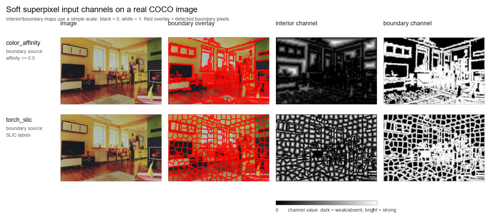

# YOLO with Superpixels

This repository is organized as a small experiment framework for trying different
ways of injecting superpixel information into YOLO. Several strategies are currently
implemented:

- `input_channels`: YOLO receives the usual RGB signal plus extra superpixel
  channels. The default is two right/down adjacency channels, but soft
  distance-to-boundary maps are also supported.
- `neck_injection`: YOLO keeps RGB input, but superpixel/token features are
  injected into the neck feature map that feeds the P3 detection branch.
- `backbone_correspondence`: YOLO keeps RGB input and uses sparse area overlap
  between P3 CNN cells and superpixel tokens. `native_backbone` changes P3
  before it contributes to P4, P5, and the P3 neck skip; `isolated_p3` changes
  only the P3 tensor consumed by its neck skip connection.
- `auxiliary_loss`: YOLO keeps RGB input for inference, but during training a
  tiny auxiliary head asks an intermediate YOLO feature map to reproduce
  superpixel right/down structure.
- `structural_supervision` (SP-11): YOLO keeps RGB input and receives a
  train-only P3 foregroundness loss; an optional SLIC-like region-consistency
  term makes predictions coherent only inside unambiguous regions.

For default `input_channels`, the two extra channels are:

1. `right`: pixel `(y, x)` and `(y, x + 1)` belong to the same superpixel.
2. `down`: pixel `(y, x)` and `(y + 1, x)` belong to the same superpixel.

The important design choice is that the dataloader, validator, predictor, and
Ultralytics warmup still see normal 3-channel images. The first `Conv2d` is
replaced with `SuperpixelConv2d`; it accepts RGB tensors, builds the extra
channels inside `forward`, and passes a 4-, 5-, or wider tensor to the real convolution.
This avoids the train/validation channel mismatch that happened when the batch
was changed in some pipeline stages but not in others.

## Project Layout

```text
src/yolo_superpixels/
  superpixels/
    algorithms.py          # SLIC, torch_slic, SPiT, OpenCV baselines, tensor affinity, custom algorithms
    adjacency.py           # label map -> adjacency and soft distance channels
  strategies/
    input_channels/        # RGB + generated superpixel input channels
      patch.py             # SuperpixelConv2d and first-conv patching
    neck_injection/        # SPiT/region token injection into the YOLO neck
      tokens.py            # SPiTTokenProvider and lightweight region tokens
      fusion.py            # add, concat, cross_attention fusion blocks
      patch.py             # auto-detect Detect.f[0] and wrap the neck layer
    backbone_correspondence/ # local P3-cell <-> superpixel token fusion
      fusion.py            # sparse overlap pooling and masked local attention
      patch.py             # native-backbone and isolated-P3 graph routing
    auxiliary_loss/        # training-only superpixel structure loss
      patch.py             # training-only auxiliary head/loss and strip helper
    structural_supervision/ # train-only box foreground and region-consistency loss
      patch.py             # SP-11 P3 head, box target, consistency loss, strip helper
    base.py                # common strategy protocol/metadata
  integrations/
    ultralytics.py         # Ultralytics YOLO trainer/wrapper
    ultralytics_neck.py    # Ultralytics wrapper for neck injection
    ultralytics_backbone.py # Ultralytics wrapper for backbone correspondence
    ultralytics_auxiliary.py # Ultralytics wrapper for auxiliary-loss training
    ultralytics_structural.py # Ultralytics wrapper for SP-11 training

configs/                   # experiment configs
examples/                  # runnable examples
tests/                     # focused tests
third_party/               # optional external research repos, preferably submodules
```

The old import paths are kept as compatibility shims. For example,
`yolo_superpixels.patch` still works, but new code should prefer the structured
locations such as `yolo_superpixels.strategies.input_channels`.

## Install

Fast setup scripts:

Windows PowerShell:

```powershell
cd path\to\YOLO_with_superpixels
powershell -ExecutionPolicy Bypass -File .\scripts\setup_windows.ps1
```

Linux:

```bash
cd /path/to/YOLO_with_superpixels
bash scripts/setup_linux.sh
```

Full install plus tests and all smoke checks:

```powershell
powershell -ExecutionPolicy Bypass -File .\scripts\setup_windows.ps1 -RunSmoke -RunNeckSmoke -RunAuxSmoke
```

```bash
bash scripts/setup_linux.sh --run-smoke --run-neck-smoke --run-aux-smoke
```

By default the scripts use CUDA PyTorch wheels when `nvidia-smi` is available,
currently `cu126`, and CPU wheels otherwise. You can override the wheel family
with `cpu`, `cu118`, `cu121`, `cu124`, or `cu126`:

```powershell
powershell -ExecutionPolicy Bypass -File .\scripts\setup_windows.ps1 -Torch cu121 -RunSmoke
```

```bash
bash scripts/setup_linux.sh --torch cu121 --run-smoke --smoke-algorithm torch_slic
```

Linux flash-attn wheel example:

```bash
bash scripts/setup_linux.sh \
  --python python3.11 \
  --torch cu118 \
  --torch-version 2.2.2 \
  --flash-attn-wheel ./flash_attn-2.7.3+cu11torch2.2cxx11abiFALSE-cp311-cp311-linux_x86_64.whl \
  --run-smoke \
  --smoke-algorithm torch_slic
```

That flash-attn wheel is Linux-only and Python 3.11-only. It cannot be installed
into the Windows `.venv` in this repository, which is Python 3.10 on Windows.

Both scripts create `.venv`, install this project in editable mode, install
Ultralytics, SLIC dependencies, CuPy, clone SPiT into `third_party/SPiT`, link
SPiT via a `.pth` file, run import checks, and run the local tests. The smoke
training runs are optional because they download/load YOLO12n weights.

For repeatable local runs, the setup scripts use
`constraints-verified-windows-py310-cu126.txt` by default when it is present.
That constraints file records the versions verified in this repository
(`ultralytics==8.4.92`, `torch==2.13.0+cu126`,
`torchvision==0.28.0+cu126`, `cupy-cuda12x==14.1.1`, and
`opencv-contrib-python==5.0.0.93` on the current Windows/Python 3.10 machine).
Pass `-NoConstraints` on Windows or `--no-constraints` on Linux if you
intentionally want a fresh dependency solve. The scripts also pin SPiT to commit
`9ad9cb81130ddbefac894094e37699807811f8ea` unless you pass a different revision.

You do not need to copy YOLO repositories into this project. Ultralytics is
installed as a dependency and resolves supported model names such as
`yolo11n.pt`, `yolo12n.pt`, and other versions supported by the installed
Ultralytics release. Custom or already trained `.pt` checkpoints can be passed
directly with `--model path\to\weights.pt`.

Manual install:

```bash
cd path/to/YOLO_with_superpixels
python -m venv .venv
.venv\Scripts\activate
pip install -e .[ultralytics,slic]
```

For a plain requirements install:

```bash
pip install -r requirements.txt
pip install -e .
pip install --no-deps git+https://github.com/dsb-ifi/SPiT.git
```

Manual installs are useful for debugging, but the setup scripts are the
preferred path because they pin the external SPiT checkout and keep the verified
dependency set together.

## Ultralytics YOLO quick start

```python
from yolo_superpixels import SuperpixelYOLO

model = SuperpixelYOLO(
    "yolo11n.pt",
    algorithm="slic",
    algorithm_kwargs={"n_segments": 300, "compactness": 10.0, "sigma": 1.0},
    init_extra="tiny",
    edge_representation="zero_centered",
)

model.train(data="data.yaml", epochs=50, imgsz=640, batch=8)
metrics = model.val(data="data.yaml", imgsz=640)
```

This is intended to work with any detection model that the installed
`ultralytics` package can load and that starts with a standard non-grouped
`nn.Conv2d`: YOLO11, YOLO12, local YAML configs, and local `.pt` checkpoints.

Pretrained/fine-tuning flow:

```python
from yolo_superpixels import SuperpixelYOLO

# Start from an already trained RGB YOLO checkpoint.
model = SuperpixelYOLO("runs/detect/train/weights/best.pt", algorithm="slic")

# The RGB weights are copied into the new 5-channel first conv. Extra-channel
# weights start tiny by default, so training begins very close to the old RGB behavior.
model.train(data="data.yaml", epochs=30, imgsz=640, lr0=1e-4)
```

Command-line example:

```bash
python examples/train_ultralytics.py --model yolo11n.pt --data data.yaml --epochs 50 --imgsz 640
```

YOLO12n with SPiT on GPU:

```bash
python examples/train_ultralytics.py \
  --model yolo12n.pt \
  --data data.yaml \
  --epochs 50 \
  --imgsz 640 \
  --batch 8 \
  --device 0 \
  --algorithm spit_dense_adjacency \
  --init-extra tiny \
  --spit-device auto
```

YOLO12n with pure PyTorch GPU SLIC-like channels:

```bash
python examples/train_ultralytics.py \
  --model yolo12n.pt \
  --data data.yaml \
  --epochs 50 \
  --imgsz 640 \
  --batch 8 \
  --device 0 \
  --algorithm torch_slic \
  --init-extra tiny \
  --edge-representation zero_centered \
  --n-segments 300 \
  --torch-slic-compactness 1.0 \
  --torch-slic-iters 7
```

Validate a trained checkpoint with the extra channels enabled and disabled:

```bash
python examples/val_ultralytics.py \
  --model runs/superpixel/yolo12n_coco_color_affinity_tiny_ft/weights/best.pt \
  --data data.yaml \
  --algorithm color_affinity \
  --edge-representation zero_centered \
  --extra-channels both \
  --imgsz 640 \
  --batch 16 \
  --device 0
```

Disabled extra channels are generated as zeros during `forward`; model weights are
not modified. This compares the same fine-tuned checkpoint with and without the
superpixel signal, but it is an out-of-distribution dependency diagnostic, not
proof by itself that the chosen superpixel method improves the detector.

Every Ultralytics training wrapper writes `superpixel_config.json` next to
Ultralytics `args.yaml`. That file records the selected strategy, algorithm or
token provider, important training args, package versions, current git state, and
the SPiT checkout commit when available. It also records `source_tree.sha256`,
a deterministic hash of the project code/config files used for the run. This is
especially useful before the first git commit, when `git.commit` is expected to
be `null`. For SPiT-based runs, the sidecar also stores a hash of the local
`third_party/SPiT` checkout contents and any configured `spit_weights` file.

### Input-Channel Representation

Input-channel training can choose how the right/down same-superpixel signal is
encoded:

| Value | Same neighbor | Boundary neighbor | Missing right/down neighbor |
| --- | ---: | ---: | ---: |
| `same` | `1` | `0` | `0` |
| `boundary` | `0` | `1` | `0` |
| `zero_centered` | `+1` | `-1` | `0` |
| `boundary_zero_centered` | `-1` | `+1` | `0` |

The default for input-channel training and validation is `zero_centered`. This
makes zero a neutral value, so disabling the extra channels with
`--extra-channels disabled` is closer to "no superpixel signal" than it was with
the old binary encoding.

Use the same representation when validating or doing algorithm-swap tests:

```bash
python examples/train_ultralytics.py \
  --model yolo12n.pt \
  --data data.yaml \
  --algorithm torch_slic \
  --edge-representation zero_centered

python examples/val_ultralytics.py \
  --model runs/superpixel/.../weights/best.pt \
  --data data.yaml \
  --algorithm torch_slic \
  --edge-representation zero_centered
```

### Soft Distance Input Channels

The input-channel strategy also supports soft maps derived from superpixel
boundaries. Label-producing algorithms such as `torch_slic`, `slic`,
`opencv_slic`, `opencv_slico`, `torch_grid`, `torch_voronoi`, or
`spit_dense_adjacency` use their integer label maps. Affinity algorithms such as
`color_affinity`, `gradient_affinity`, and `color_gradient_affinity` do not
produce labels, so the builder treats low right/down affinity values as boundary
evidence instead. Use `--soft-affinity-threshold` to choose the cutoff.

| `--channel-mode` | Channels | Meaning |
| --- | ---: | --- |
| `soft_interior` | `RGB + 1` | One distance-to-boundary map. Label methods are normalized per superpixel; affinity methods are normalized by `--soft-max-distance`. |
| `soft_boundary` | `RGB + 1` | One soft boundary-band map. Boundaries are `1`, and the value fades with distance. |
| `soft_boundary_interior` | `RGB + 2` | Boundary map followed by interior map. |

The following figure shows the new channels on a real COCO image. Red pixels in
the overlay are detected boundary pixels for visualization only. The actual
extra channels are grayscale tensors: black is `0`, white is `1`.



`color_affinity` is an affinity source, not a true label-based superpixel
algorithm. It compares right/down neighboring pixels and treats affinity values
below `--soft-affinity-threshold` as boundary evidence. This makes it closer to
a fast local edge/contrast signal. `torch_slic` is label-based, so it produces
SLIC-like regions; its interior channel is normalized inside each region.

Examples for the three planned experiments:

```bash
python examples/train_ultralytics.py \
  --model yolo12n.pt \
  --data data.yaml \
  --algorithm torch_slic \
  --channel-mode soft_interior \
  --init-extra tiny

python examples/train_ultralytics.py \
  --model yolo12n.pt \
  --data data.yaml \
  --algorithm torch_slic \
  --channel-mode soft_boundary \
  --init-extra tiny

python examples/train_ultralytics.py \
  --model yolo12n.pt \
  --data data.yaml \
  --algorithm torch_slic \
  --channel-mode soft_boundary_interior \
  --init-extra tiny
```

Visualize these channels for one image:

```bash
python scripts/visualize_soft_distance_channels.py \
  --image path/to/image.jpg \
  --algorithm torch_slic color_affinity \
  --channel-mode soft_interior soft_boundary soft_boundary_interior \
  --device 0
```

For cluster/manual benchmarks, pass the same mode through
`scripts/run_coco_manual_benchmark.py`:

```bash
python scripts/run_coco_manual_benchmark.py \
  --data /path/to/coco/data.yaml \
  --stage rgb input \
  --models yolo12n.pt yolo26n.pt \
  --input-algorithm torch_slic \
  --input-control-algorithm none \
  --input-channel-mode soft_interior \
  --epochs 70 \
  --batch 64 \
  --device 0
```

### Current Research Status

Implemented and locally verified:

- `adjacency`: RGB plus right/down superpixel adjacency or affinity channels.
- `soft_interior`: RGB plus one distance-from-boundary channel.
- `soft_boundary`: RGB plus one soft boundary-band channel.
- `soft_boundary_interior`: RGB plus both soft boundary and soft interior
  channels.
- Channel disabling for ablations, so a trained wider model can be evaluated
  with generated extra channels set to zero.
- GPU-native paths for `color_affinity`, `gradient_affinity`,
  `color_gradient_affinity`, `torch_slic`, `torch_grid`, and `torch_voronoi`.
- Neck injection and auxiliary-loss strategies for later experiments.

Local validation on 2026-08-12:

- `ruff check .`: passed.
- `pytest -q`: `62 passed, 1 skipped`.
- One-image YOLO12n smoke training passed for `color_affinity` with
  `soft_interior`, `soft_boundary`, and `soft_boundary_interior`.

Cluster screening in progress on COCO:

| Model | Method | Channel mode | Status | Last observed COCO `mAP50-95` | Notes |
| --- | --- | --- | --- | ---: | --- |
| YOLO12n | `color_affinity` | `soft_interior` | complete, 70 epochs | `0.39575` | Transfer learning from `yolo12n.pt`. |
| YOLO12n | `color_affinity` | `soft_boundary` | complete, 70 epochs | `0.39574` | Essentially tied with `soft_interior`. |
| YOLO12n | `color_affinity` | `soft_boundary_interior` | running at last check | `0.35143` at epoch 16 | Too early to judge. |
| YOLO26n | `color_affinity` | all three soft modes | queued | - | Starts after the YOLO12n and pretrained-baseline jobs. |
| YOLO12n/YOLO26n | RGB pretrained checkpoints | validation only | queued | - | Needed to compare against the downloaded models directly. |

Preliminary interpretation: the two completed YOLO12n soft-channel runs do not
yet show a clear gain. A fair conclusion requires comparing them with the
downloaded pretrained checkpoint and with a matched RGB-only fine-tune under the
same data, epochs, batch size, seed, and scheduler.

## Neck injection quick start

The `neck_injection` strategy does not change the first convolution and does not
add image input channels. Instead, it patches the YOLO neck. The default target
is detected from the final `Detect` layer:

```text
target = Detect.f[0]
```

For YOLO12 this is usually layer `14`; for YOLO26 this is usually layer `16`.
This is the P3/8 neck feature after the top-down upsample path and before the
bottom-up PAN downsampling path.

Three fusion modes are implemented:

| Mode | What it does | Runtime expectation |
| --- | --- | --- |
| `add` | Projects superpixel tokens to YOLO channels and adds them with a learnable gate. | Cheapest and safest first experiment. |
| `concat` | Concatenates YOLO feature + superpixel feature, then applies a 1x1 conv initialized close to identity. | Slightly heavier, more flexible. |
| `cross_attention` | Uses YOLO feature locations as queries and superpixel tokens as keys/values. | Most expressive and most expensive. |

There are three token providers:

| Provider | Meaning | Status |
| --- | --- | --- |
| `region` | Lightweight GPU-native region tokens from `torch_slic`, `torch_grid`, or `torch_voronoi` labels using mean RGB/position features. | This is not full SPiT tokenization; it is the practical first neck baseline. |
| `spit_labels` | Uses Marius/SPiT content-aware superpixel tokenizer for labels, then builds lightweight mean RGB/position region tokens. | Recommended first SPiT-based neck experiment. |
| `spit` | Full SPiT path: tokenizer, interpolation/histogram extractor, embedder, masked ViT blocks. | Requires `--spit-weights` by default. Random full SPiT is allowed only with an explicit ablation flag. |

Recommended first neck experiment with GPU `torch_slic` region tokens:

```bash
python examples/train_ultralytics_neck.py \
  --model yolo12n.pt \
  --data data.yaml \
  --epochs 50 \
  --imgsz 640 \
  --batch 8 \
  --device 0 \
  --fusion add \
  --token-provider region \
  --region-algorithm torch_slic \
  --region-n-segments 300 \
  --region-num-iters 7 \
  --spit-image-size 160 \
  --project runs/superpixel_neck \
  --name yolo12n_region_slic_add
```

SPiT-label neck injection using Marius's superpixel tokenizer:

```bash
python examples/train_ultralytics_neck.py \
  --model yolo12n.pt \
  --data data.yaml \
  --epochs 50 \
  --imgsz 640 \
  --batch 8 \
  --device 0 \
  --fusion add \
  --token-provider spit_labels \
  --spit-image-size 160 \
  --project runs/superpixel_neck \
  --name yolo12n_spit_labels_add
```

Full SPiT token path, experimental:

```bash
source .venv/spit_cuda_env.sh  # Linux GPU clusters after scripts/setup_linux.sh
export CUPY_CACHE_DIR="${CUPY_CACHE_DIR:-$PWD/.cache/cupy}"
python examples/train_ultralytics_neck.py \
  --model yolo12n.pt \
  --data data.yaml \
  --epochs 50 \
  --imgsz 640 \
  --batch 8 \
  --device 0 \
  --fusion cross_attention \
  --token-provider spit \
  --spit-tokenizer superpixel \
  --spit-weights path/to/spit_checkpoint.pt \
  --spit-image-size 160 \
  --project runs/superpixel_neck \
  --name yolo12n_full_spit_tokens_cross_attention
```

If you deliberately want a random-SPiT ablation, add `--allow-random-spit`.
Without pretrained SPiT weights, the full token path is not a meaningful
Marius/SPiT representation; it is only a control experiment. Full
`token_provider=spit` runs the SPiT tokenizer, interpolation/histogram extractor,
embedder, masked ViT blocks, and normalization before the YOLO neck attention
block. CUDA tensors stay on CUDA in the project wrapper; SPiT itself uses CuPy
RawKernels through DLPack, so the first call may spend time compiling kernels.
On Linux clusters, `scripts/setup_linux.sh` installs the CUDA12 NVRTC/runtime
helper packages and writes `.venv/spit_cuda_env.sh`; source that file in Slurm
jobs before running full SPiT. Set a stable `CUPY_CACHE_DIR` and throughput-test
this path before a long run, because the full extractor/embedder path is heavier
than `region` or `spit_labels`.

On Windows PowerShell, set the same cache variable with:

```powershell
$env:CUPY_CACHE_DIR = "$PWD\.cache\cupy"
```

Validate with injection enabled and disabled:

```bash
python examples/val_ultralytics_neck.py \
  --model runs/superpixel_neck/yolo12n_region_slic_add/weights/best.pt \
  --data data.yaml \
  --fusion add \
  --token-provider region \
  --region-algorithm torch_slic \
  --injection both \
  --device 0
```

Smoke test all fusion modes:

```bash
python examples/smoke_train_neck_injection.py \
  --model yolo12n.pt \
  --device 0 \
  --imgsz 64 \
  --fusion add concat cross_attention \
  --token-provider region \
  --region-algorithm torch_slic
```

## Backbone Correspondence

`backbone_correspondence` is distinct from the older global P3 neck attention.
It uses a superpixel label map after augmentation to build sparse raster overlap
edges between every P3 CNN cell and only the superpixel tokens that occupy part
of that cell. `overlap_attention` makes the CNN cell a query over those local
tokens; `overlap_pool` is the non-attention correspondence control.

Two routes are available:

| Placement | Graph effect |
| --- | --- |
| `native_backbone` | Patches the original backbone P3 tensor. Its enriched output subsequently contributes to P4, P5, and the P3 neck skip. |
| `isolated_p3` | Leaves the original P3 tensor to build P4/P5, and replaces only the P3 input at its neck consumer. |

For YOLO12n/YOLO26n at 640 px, the resolved source is backbone layer `4`
(`B x 128 x 80 x 80`). The resolved P3 consumers are layers `13` and `15`,
respectively. The resolver validates the P3 stride through a real forward rather
than assuming fixed layer indices for all future Ultralytics architectures.

The first intended experiment uses a frozen official SPiT-S16 checkpoint and a
trainable correspondence fusion module. The command below is a short technical
smoke; use a matched RGB-only fine-tune before interpreting accuracy.

```bash
python examples/train_ultralytics_backbone.py \
  --model yolo12n.pt \
  --data data.yaml \
  --epochs 2 \
  --imgsz 640 \
  --batch 1 \
  --workers 0 \
  --device 0 \
  --placement native_backbone \
  --fusion overlap_attention \
  --token-provider spit \
  --spit-weights path/to/SPiT_model_SPiT_S16_grad.pth \
  --spit-train-mode frozen \
  --spit-emb-dim 384 \
  --spit-num-bins 16 \
  --spit-heads 6 \
  --spit-depth 12 \
  --spit-keep-k 0 \
  --spit-image-size 160 \
  --no-bbox-reg
```

Replace `--placement native_backbone` with `--placement isolated_p3` for the
route-specific control. `keep_k=0` is intentional: SPiT budget dropout was not
stable in historical batched CUDA runs. Full SPiT is computed on the input CUDA
device; the correspondence module uses GPU tensor grouping/scatter operations
and never constructs CPU polygons.

Visualize one real image and the routing diagrams:

```bash
python scripts/visualize_backbone_correspondence.py \
  --image path/to/image.jpg \
  --output visualizations/backbone_correspondence.png \
  --device cuda:0
```

The visualizer is an explanatory tool, so it may copy labels to CPU after GPU
computation to render a PNG. That copy is not part of model training or inference.

The opt-in lifecycle smoke covers one epoch of training followed by fresh-process
checkpoint load, validation, and prediction for both routes:

```bash
python scripts/run_e2e_smoke.py \
  --strategy backbone_native backbone_isolated \
  --model yolo12n.pt \
  --device 0 \
  --require-cuda
```

## Auxiliary loss quick start

The `auxiliary_loss` strategy does not change the RGB input and does not inject
anything into the detection head at inference time. During `model.train()` it
wraps one intermediate YOLO module, adds a tiny auxiliary head, and asks that
feature map to predict superpixel right/down adjacency at the same spatial size.
The auxiliary loss is added to the normal YOLO detection loss and is logged as
`train/sp_loss` in Ultralytics `results.csv`.

When an algorithm can return a label map on the tensor path, the target builder
first resizes the labels to the feature-map size with nearest-neighbor sampling
and then computes right/down adjacency there. This keeps the target semantics at
P3/P4/P5 feature resolution. Only algorithms that cannot expose labels fall back
to resizing already-built edge channels. The default auxiliary objective is
`balanced_bce`, because right/down adjacency is often class-imbalanced.

By default the target layer is detected as:

```text
target = Detect.f[0]
```

This is the highest-resolution P3 feature that feeds the Detect head. You can
override it with `--target-layer`.

Recommended first run with GPU `torch_slic` targets:

```bash
python examples/train_ultralytics_auxiliary.py \
  --model yolo12n.pt \
  --data data.yaml \
  --epochs 50 \
  --imgsz 640 \
  --batch 8 \
  --device 0 \
  --algorithm torch_slic \
  --n-segments 300 \
  --compactness 1.0 \
  --num-iters 7 \
  --loss-weight 0.05 \
  --project runs/superpixel_auxiliary \
  --name yolo12n_aux_slic
```

Multiple target algorithms are supported. Each algorithm contributes two target
channels:

```bash
python examples/train_ultralytics_auxiliary.py \
  --model yolo12n.pt \
  --data data.yaml \
  --algorithm torch_slic gradient_affinity \
  --loss-weight 0.05
```

The checkpoint keeps the auxiliary head weights. This is intentional: you can
resume/fine-tune the same auxiliary experiment later and the head weights will
load when you use `examples/train_ultralytics_auxiliary.py` again. During
`eval()`, `val()`, and `predict()`, the auxiliary wrapper returns the normal YOLO
feature without running superpixelization or the auxiliary head. Validation
during training still reports `val/sp_loss` as `0`, so Ultralytics keeps a stable
four-column loss layout.

If you later want a plain YOLO checkpoint with the auxiliary module removed:

```bash
python examples/strip_auxiliary_loss.py \
  --model runs/superpixel_auxiliary/yolo12n_aux_slic/weights/best.pt \
  --output runs/superpixel_auxiliary/yolo12n_aux_slic/weights/best_stripped.pt
```

Smoke test:

```bash
python examples/smoke_train_auxiliary_loss.py \
  --model yolo12n.pt \
  --device 0 \
  --imgsz 64 \
  --algorithm torch_slic
```

Dense vs sparse terminology in this repository:

- A dense YOLO feature map has a value at every grid location, for example
  `B x C x 80 x 80`.
- Sparse/variable superpixel tokens have one vector per superpixel, for example
  `B x N x D`, where `N` can change per image.
- `tokens_to_dense_map()` scatters token vectors back to a dense map by resizing
  the superpixel label map to the YOLO feature size and gathering the token that
  owns each location.

Multi-GPU Ultralytics training can use the normal device argument:

```bash
python examples/train_ultralytics.py --model yolo11n.pt --data data.yaml --device 0,1,2,3
```

For DDP, use serializable algorithms such as `slic`, `torch_slic`, or
`spit_dense_adjacency`. Arbitrary Python callables work in a single process, but
child DDP processes cannot import a local lambda or closure.

## Switching algorithms

SLIC:

```python
model = SuperpixelYOLO(
    "yolo11n.pt",
    algorithm="slic",
    algorithm_kwargs={"n_segments": 500, "compactness": 15.0},
)
```

Torch-native SLIC-like GPU clustering:

```python
model = SuperpixelYOLO(
    "yolo12n.pt",
    algorithm="torch_slic",
    algorithm_kwargs={"n_segments": 300, "compactness": 1.0, "num_iters": 7},
)
```

SPiT dense labels converted to right/down adjacency channels. This is the SPiT
variant to use when you want the same channel semantics as SLIC: channel 0 says
whether the right neighbor is in the same SPiT segment, and channel 1 does the
same for the down neighbor.

```python
model = SuperpixelYOLO(
    "yolov12n.pt",
    algorithm="spit_dense_adjacency",
    algorithm_kwargs={
        "module_path": "spit.tokenizer.densesp",
        "class_name": "DenseSPEdgeEmbedder",
        "device": "auto",
    },
)
```

Raw SPiT dense edge channels are still available as `algorithm="spit"` for
diagnostics, but they are not directly comparable to the adjacency methods
because their value range and meaning differ.

Fast GPU-only color-affinity baseline:

```python
model = SuperpixelYOLO(
    "yolo12n.pt",
    algorithm="color_affinity",
    algorithm_kwargs={"temperature": 0.1, "reduction": "l2"},
)
```

This is not a SLIC replacement; it simply encodes neighboring RGB similarity in
the same right/down channel format. It is useful for checking the speed and value
of the input-channel idea without CPU superpixel overhead.

Fast GPU-only gradient/texture affinity baseline:

```python
model = SuperpixelYOLO(
    "yolo12n.pt",
    algorithm="gradient_affinity",
    algorithm_kwargs={"temperature": 0.1, "reduction": "l2"},
)
```

For a mixed local RGB + gradient signal, use `algorithm="color_gradient_affinity"`.

SPiT/RViT pseudo-Voronoi baseline:

```python
model = SuperpixelYOLO(
    "yolo12n.pt",
    algorithm="spit_voronoi",
    algorithm_kwargs={"num_cells": 256},
)
```

This uses the PCA-tree pseudo-Voronoi partitioning shipped with SPiT. It is a
GPU-friendly irregular-partition control, not a color-aware superpixel method.

OpenCV ximgproc baselines:

```python
model = SuperpixelYOLO(
    "yolo12n.pt",
    algorithm="opencv_slico",
    algorithm_kwargs={"n_segments": 300, "iterations": 10, "convert_to_lab": True},
)
```

Available names are `opencv_slic`, `opencv_slico`, `opencv_mslic`,
`opencv_lsc`, and `opencv_seeds`. These use `cv2.ximgproc` and are CPU-only in
OpenCV's Python package, so they are best for baselines, small runs, or
precomputation rather than long on-the-fly training.

Quick algorithm map:

| Name | Backend | Strict GPU | Notes |
| --- | --- | --- | --- |
| `color_affinity` / `gpu_affinity` | PyTorch | yes | Fast right/down RGB affinity, not true superpixels. |
| `gradient_affinity` / `texture_affinity` | PyTorch | yes | Sobel-gradient/texture affinity, useful against color affinity. |
| `color_gradient_affinity` | PyTorch | yes | Mixed local RGB + gradient affinity. |
| `torch_slic` / `gpu_slic` | PyTorch | yes | SLIC-like local clustering; default compactness is lower than CPU SLIC because RGB is normalized to `[0, 1]`. |
| `torch_grid` / `gpu_grid` | PyTorch | yes | Control baseline only. Regular grid, not content-aware; not recommended for training. |
| `torch_voronoi` / `gpu_voronoi` | PyTorch | yes | Control baseline only. Spatial Voronoi, not content-aware; not recommended for training. |
| `spit_dense_adjacency` / `spit_adjacency` | SPiT + PyTorch/CuPy | GPU tensor path | Runs `DenseSPEdgeEmbedder(return_seg=True)`, then converts labels to binary right/down adjacency. |
| `spit` | SPiT + PyTorch/CuPy | GPU tensor path | Raw `DenseSPEdgeEmbedder` channels; useful for diagnostics, not directly comparable to right/down adjacency. |
| `spit_voronoi` / `pseudo_voronoi` | SPiT + PyTorch | GPU tensor path, not strict | Control baseline only. Pseudo-Voronoi partition, not content-aware; not recommended for training. |
| `slic` | scikit-image | no | Exact CPU scikit-image SLIC/SLICO-style baseline. |
| `opencv_*` | OpenCV ximgproc | no | CPU SLIC/SLICO/MSLIC/LSC/SEEDS baselines. |

Runtime GPU check:

```bash
python scripts/check_gpu_superpixel_methods.py --height 640 --width 640 --batch 1 --device cuda:0
```

The curated list is stored in `configs/gpu_superpixel_methods.yaml`.

`torch_grid`, `torch_voronoi`, and `spit_voronoi` are intentionally kept in the
codebase as negative/control baselines. They are not broken, but they are not
image-adaptive superpixel methods: grid returns regular squares, Voronoi returns
spatial cells, and pseudo-Voronoi returns an irregular partition that does not
try to follow object/color boundaries. For real training runs, prefer
`torch_slic`, `color_affinity`, `gradient_affinity`,
`color_gradient_affinity`, `spit_dense_adjacency`, or neck
`token_provider=spit_labels`.

Terminology note: this repository intentionally keeps several different kinds
of signals under one experiment framework, but they are not all the same thing.
CPU `slic`/OpenCV and `torch_slic` are superpixel-style label methods,
`spit_dense_adjacency` uses SPiT dense labels, affinity methods encode local
neighbor similarity, and grid/Voronoi methods are negative controls. Compare
methods within those caveats instead of treating every two-channel tensor as an
equivalent "superpixel" representation.

Multiple input-channel methods:

```bash
# RGB only: do not pass --algorithm.
python examples/train_ultralytics.py --model yolo12n.pt --data data.yaml

# RGB + 2 channels.
python examples/train_ultralytics.py \
  --model yolo12n.pt \
  --data data.yaml \
  --algorithm color_affinity \
  --edge-representation zero_centered

# RGB + 4 channels.
python examples/train_ultralytics.py \
  --model yolo12n.pt \
  --data data.yaml \
  --algorithm color_affinity gradient_affinity \
  --edge-representation zero_centered

# Equivalent append style.
python examples/train_ultralytics.py \
  --model yolo12n.pt \
  --data data.yaml \
  --algorithm color_affinity \
  --extra-algorithm gradient_affinity
```

For `--channel-mode adjacency`, the first convolution is expanded to
`3 + 2 * number_of_algorithms` channels. For `soft_interior` or
`soft_boundary`, it is expanded to `3 + number_of_algorithms`. For
`soft_boundary_interior`, it is expanded to `3 + 2 * number_of_algorithms`.
A checkpoint trained with one channel layout must be validated with the same
layout. To combine two methods, fine-tune/train a wider model with both methods
listed in `--algorithm`.

Custom label-map algorithm:

```python
import numpy as np
from yolo_superpixels import CallableSuperpixelAlgorithm, SuperpixelYOLO

def my_superpixels(rgb_image: np.ndarray) -> np.ndarray:
    # Return HxW integer labels.
    ...

model = SuperpixelYOLO(
    "yolo11n.pt",
    algorithm=CallableSuperpixelAlgorithm(my_superpixels),
    algorithm_name=None,
)
```

For adjacency mode, the algorithm may also return prebuilt edge channels with
shape `2xHxW` or `HxWx2`, or a five-channel output where channels 3 and 4 are
the extra channels. For soft distance modes, labels are preferred, but raw
right/down edge or affinity channels are accepted as a fallback boundary source.
For high-throughput GPU training, custom algorithms can additionally implement
`edges_for_batch(batch_tensor, channel_order=("right", "down"))` and return a
torch tensor with shape `Bx2xHxW`. Custom edge tensors should use the raw
same-neighbor convention in `[0, 1]`; `AdjacencyChannelBuilder` applies
`--edge-representation` afterward, while `DistanceChannelBuilder` thresholds
them with `--soft-affinity-threshold`. For GPU-native label-based soft distance
modes, implement `labels_for_batch(batch_tensor)` and return integer labels with
shape `BxHxW`.

## Dependencies and External Repos

You do not need to fork Ultralytics for the current `input_channels` strategy.
Install it as a normal dependency:

```bash
pip install ultralytics
```

For SLIC, install `scikit-image`:

```bash
pip install scikit-image
```

For OpenCV SLIC/SLICO/MSLIC/LSC/SEEDS baselines, install OpenCV contrib:

```bash
pip install opencv-contrib-python
```

For SPiT or other research code, there are two reasonable options:

- If it is packaged, add it to `requirements.txt` or an optional dependency in
  `pyproject.toml`.
- SPiT itself is prepared by the setup scripts: they clone
  `https://github.com/dsb-ifi/SPiT.git` into `third_party/SPiT` and link it with
  a `.pth` file. The checkout itself is ignored by Git.
- If another repo is only a GitHub/research repository, put it under
  `third_party/`, preferably as a git submodule, and pass its import path
  through `algorithm_kwargs`.

So the default workflow is: keep this repository as your experiment code, install
stable libraries from PyPI, and only vendor/submodule external research repos
when they are not installable packages.

## Generic PyTorch model

```python
from yolo_superpixels import AdjacencyChannelBuilder, SLICSuperpixelAlgorithm, patch_first_conv2d

builder = AdjacencyChannelBuilder(SLICSuperpixelAlgorithm(n_segments=300))
patch_first_conv2d(model, builder)

# Still call the model with RGB input.
pred = model(images_rgb)
```

## Notes

- Extra-channel weights are initialized with tiny random values by default, so a
  pretrained RGB model starts very close to the original behavior but the new
  channels are not exactly zeroed. Use `init_extra="zero"`, `"mean"`, or
  `"kaiming"` if you want a different initialization.
- To ablate the learned extra-channel signal after training, validate or predict
  with `extra_channels_enabled=False` or use
  `examples/val_ultralytics.py --extra-channels disabled`. This zeros the two
  generated input channels and leaves all learned weights unchanged. With the
  default `edge_representation="zero_centered"`, zero is the intended neutral
  value.
- To ablate neck injection, use
  `examples/val_ultralytics_neck.py --injection disabled` or `--injection both`.
- Auxiliary-loss checkpoints keep the auxiliary head weights for future
  fine-tuning, but the block is training-only: in `eval()`, `val()`, and
  `predict()` it does not compute superpixel targets or add a loss.
- To remove auxiliary-loss weights from a checkpoint, use
  `examples/strip_auxiliary_loss.py`.
- The original first convolution must be a non-grouped `nn.Conv2d` with 3 input
  channels, or an already-patched convolution with `3 + 2N` channels. This covers
  standard Ultralytics YOLO detection models and resumed superpixel checkpoints.
- Ultralytics Conv+BN fuse is disabled for patched models. Without this guard,
  standalone `val`/`predict` can replace `SuperpixelConv2d` with a plain
  five-channel `Conv2d` before warmup.
- Because superpixelization is dynamic preprocessing inside `forward`, normal
  PyTorch/Ultralytics training and validation are supported, but ONNX/TensorRT
  export of the dynamic preprocessing path is not supported.
- On-the-fly CPU SLIC/OpenCV methods are CPU-heavy. For large experiments,
  reduce `n_segments`, cache precomputed channels, or use a tensor-native
  algorithm. If a CPU algorithm is used inside `forward`, a CUDA image tensor
  must be converted through CPU/NumPy and copied back, which can dominate
  training time.
- `color_affinity`, `gradient_affinity`, `color_gradient_affinity`,
  `torch_slic`, `torch_grid`, and `torch_voronoi` are strict PyTorch tensor
  paths and can keep preprocessing on the GPU. CPU `slic` and `opencv_*` remain
  NumPy/OpenCV algorithms.
- Full neck `token_provider="spit"` requires pretrained SPiT weights unless you
  pass `--allow-random-spit`. The lighter `spit_labels` provider uses SPiT for
  content-aware labels and then builds simple region tokens.
- Algorithm errors are not swallowed by default. Set `fail_open=True` only when
  you intentionally want failed superpixelization to produce zero extra channels.

## Adding a New Strategy

Use the existing strategy folders as templates. New RGB+channels experiments go
under `strategies/input_channels`, feature/token fusion experiments go under
`strategies/neck_injection`, and training-only supervision such as additional
backbone/neck losses goes under `strategies/auxiliary_loss`. Framework-specific
glue, such as a custom Ultralytics trainer, should live under `integrations/`.

## Tests

```bash
ruff check --no-cache src tests examples scripts
pytest
```

The real integration tests use local `yolo12n.pt` and `yolo26n.pt` weights when
they are present in the repository root. They verify that neck injection targets
the expected P3/8 layer (`14` for YOLO12n, `16` for YOLO26n), that all fusion
parameters exist before optimizer creation, that real forward passes work, and
that the auxiliary-loss criterion returns/logs a fourth `sp_loss` item.

Local smoke checks that were used while hardening this prototype:

```powershell
.\.venv\Scripts\python.exe examples\smoke_train_neck_injection.py --model yolo12n.pt --device cpu --imgsz 64 --fusion add --token-provider region --region-algorithm torch_slic --scratch-dir runs\smoke_neck
.\.venv\Scripts\python.exe examples\smoke_train_auxiliary_loss.py --model yolo12n.pt --device cpu --imgsz 64 --algorithm torch_slic --scratch-dir runs\smoke_auxiliary
```

For a production-like lifecycle smoke on a tiny generated dataset, run:

```powershell
.\.venv\Scripts\python.exe scripts\run_e2e_smoke.py `
  --strategy input `
  --model yolo12n.pt `
  --device 0 `
  --require-cuda `
  --scratch-dir runs\e2e_input
```

This launches separate Python processes for train, checkpoint load + val, and
checkpoint load + predict. To run the same lifecycle for all current strategies,
use `--strategy input neck auxiliary structural`. The pytest wrapper is opt-in:

```powershell
$env:YOLO_SUPERPIXELS_RUN_E2E="1"
$env:YOLO_SUPERPIXELS_E2E_DEVICE="0"
$env:YOLO_SUPERPIXELS_E2E_REQUIRE_CUDA="1"
.\.venv\Scripts\python.exe -m pytest tests\test_end_to_end_smoke.py -q
```

## SP-11 Matched Pilot

SP-11 is a separate train-only strategy: a P3 foregroundness head receives a
box-derived target and can be regularized inside pure SLIC-like regions. It is
not the historical right/down adjacency `auxiliary_loss` strategy.

`configs/sp11/pilot_v1.yaml` is a technical pretrained smoke only.
`configs/sp11/scientific_paired_scratch_v1.yaml` is the scientific protocol:
it creates one deterministic physical YOLOv12n scratch checkpoint from the
tracked architecture YAML, then all A/B/C/D arms load that exact checkpoint.
Both use the same intervention-only arm files. Do not pass training-
hyperparameter overrides on the command line.
Set the dataset location once, inspect the frozen resolved configuration, and
only then launch:

```powershell
$env:SP11_DATA_YAML = "F:\path\to\data.yaml"
.\.venv\Scripts\python.exe scripts\run_sp11_pilot.py --dry-run
```

The dry run writes a manifest containing checkpoint SHA-256, deterministic
image/label dataset manifests and hashes, the common protocol SHA, and every
arm SHA. It prints `PAIRED_PROTOCOL_CHECK: PASS` only after all invariants
match. A supplied checkpoint SHA is verified; unresolved data or a
training-field override inside an arm fails before any run begins.

For a separately frozen short GPU smoke protocol, use the same launcher with:

```powershell
.\.venv\Scripts\python.exe scripts\run_sp11_pilot.py `
  --arm A B C D `
  --loss-scale-diagnostic-batches 4 `
  --runtime-profile
```

This records wall time per epoch, peak VRAM, images/sec when available, and C/D
structural-preprocessing/consistency time. It records separate foreground and
region gradient norms into the P3 foreground logits and does not tune loss
weights. The main pilot must keep `lambda_fg` and `lambda_sp` frozen after
human review of this diagnostic smoke.

## Visualizing Superpixel Methods

Use `scripts/visualize_superpixel_methods.py` to compare superpixel methods on
one image before spending GPU hours on training. The script writes a single grid
image and a JSON metadata file. The grid shows the original image at the top,
then one row per method with boundary overlay and pseudo-colored segment labels.

For a specific image:

```powershell
.\.venv\Scripts\python.exe scripts\visualize_superpixel_methods.py `
  --image "path\to\image.jpg" `
  --output-dir "runs\visualizations" `
  --device cuda:0 `
  --only-gpu
```

For a random COCO image:

```powershell
.\.venv\Scripts\python.exe scripts\visualize_superpixel_methods.py `
  --coco-root "path\to\coco" `
  --output-dir "runs\visualizations" `
  --device cuda:0 `
  --only-gpu
```

By default the script shows the recommended methods and hides structural
controls such as grid/Voronoi. Add `--include-controls` to display those
baselines too. Full SPiT dense tokenization is skipped by default because it was
slow and unstable on the verified Windows/CuPy environment; use
`--run-spit-dense` only for a targeted diagnostic. Generated visualization
outputs are intentionally ignored by git when they are placed under `runs/` or
the local `visualizations/` folder.

## Long Manual COCO Benchmark

For a long human-reviewed integration gate before moving to a supercomputer, use:

```powershell
.\.venv\Scripts\python.exe scripts\run_coco_manual_benchmark.py `
  --data "path\to\coco\data.yaml" `
  --epochs 70 `
  --models yolo12n.pt yolo26n.pt `
  --imgsz 640 `
  --batch 16 `
  --workers 4 `
  --device 0 `
  --edge-representation zero_centered `
  --run-root "runs\coco_manual_benchmark"
```

This is deliberately a manual benchmark script, not a pytest test. It is meant
to catch integration/protocol problems and produce review tables; it is not, by
itself, enough evidence for a PhD claim. By default it launches:

- 2 paired RGB-only fine-tunes: YOLO12n and YOLO26n with the same dataset,
  epochs, optimizer settings, seed, augmentations, and image size;
- 8 input-channel fine-tunes: YOLO12n and YOLO26n with primary `torch_slic`, plus
  training controls `color_affinity`, `torch_grid`, and `torch_voronoi`;
- an input-channel algorithm-swap validation matrix on the trained checkpoints;
- 6 neck-injection fine-tunes: YOLO12n/YOLO26n times `add`, `concat`, and
  `cross_attention`;
- 2 auxiliary-loss fine-tunes: YOLO12n and YOLO26n with `torch_slic` targets.

All runs start from pretrained `.pt` weights, not model YAMLs from scratch.
Ultralytics will download supported model names when possible; otherwise place
the `.pt` file in the repository root or pass an explicit path in `--models`.

Useful planning command:

```powershell
.\.venv\Scripts\python.exe scripts\run_coco_manual_benchmark.py `
  --data "path\to\coco\data.yaml" `
  --run-root "runs\coco_manual_dryrun" `
  --dry-run
```

The script writes:

- `reports/manifest.json`: exact commands plus `source_tree.sha256`,
  SPiT checkout metadata, optional `spit_weights` hash, and
  `external_fingerprint`;
- `reports/dataset_snapshot.json`: train/val/test image, label-file, and object
  counts when the YOLO dataset layout can be resolved;
- `reports/summary.csv`: compact machine-readable status, wall time, peak VRAM,
  GPU utilization, and approximate GPU energy when `nvidia-smi` is available;
- `reports/summary.md`: human review table and checklist with the same cost
  metrics;
- `logs/*.log`: full stdout/stderr for every long run.

Use `--stage rgb`, `--stage input swap`, `--stage neck`, or
`--stage auxiliary` to run only part of the matrix. By default a run is skipped
only if `results.csv`, `weights/best.pt`, and
`yolo_superpixels_job_complete.json` exist, the marker matches the current
command hash, the source-tree hash still matches, and the last logged epoch
reaches the requested epoch budget. For SPiT-related runs, the external
fingerprint must also match the current SPiT checkout and weights. Use `--rerun`
to force reruns.

The swap matrix is only an out-of-distribution dependency diagnostic. A metric
drop under algorithm swap means the checkpoint depends on the trained channel
distribution; it does not prove that one superpixel algorithm is scientifically
better than another, and it does not replace the paired RGB baseline.

Raw/full SPiT is not part of the default long matrix. `spit_dense_adjacency` is
available for targeted checks, but it should pass a separate compute go/no-go
before being added to long training runs.
